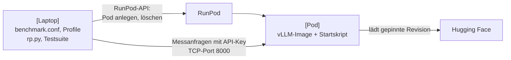

# Anleitung: Modelle messen

Schritt für Schritt vom leeren Rechner bis zur Vergleichstabelle. Jeder Schritt sagt, **wo** er passiert und **was dabei geschieht**.

## Die drei Orte

| Kürzel | Ort | Was dort passiert |
|---|---|---|
| **[Laptop]** | Terminal auf deinem Steuerrechner (Laptop, PC mit WSL, Server), im Ordner `SwarmLLM_Benchmark` | Du tippst alle Befehle hier. Hier liegen `benchmark.conf`, Profile und Ergebnisse. |
| **[Web]** | Weboberfläche des Anbieters (RunPod, Google Cloud …) | Nur Einmaliges: Konto, Kartenlimit, API-Key. Beim RunPod-Weg legst du dort **keinen Pod von Hand** an. |
| **[Pod]** | der gemietete GPU-Server | Läuft von selbst: Hardware prüfen, Modell laden, vLLM starten. Du musst dich dort nicht anmelden. |



**Wichtig:** vLLM musst du nirgends installieren. Jeder Pod startet direkt mit dem fertigen vLLM-Image aus dem Profil – bei Qwen das offizielle `vllm/vllm-openai`, bei GLM das gepatchte vLLM von Local Inference Lab („Karmic Kraken“).

---

## Teil 1 – Einmalig einrichten (kostenlos)

### 1.1 Konto und Limit [Web]

1. RunPod-Konto anlegen, Firmenkarte hinterlegen und **ein Ausgabenlimit setzen**. Das Limit ist die einzige Kostenbremse über alle Läufe; die Skripte zeigen Kosten nur an.
2. Unter **Settings → API Keys** einen Key nur für dieses Projekt anlegen und kopieren.
3. Bei Hugging Face unter **Settings → Access Tokens** einen Read-Token anlegen.

### 1.2 Steuerrechner vorbereiten [Laptop]

Auf Windows in **WSL2 mit Ubuntu**, auf Linux oder macOS direkt im Terminal:

```bash
python3 --version                  # mindestens 3.11
sudo apt install -y git openssl    # Ubuntu/WSL; macOS hat beides meist schon
git clone https://github.com/Kalavera1/SwarmLLM_Benchmark.git
cd SwarmLLM_Benchmark
```

Optional für die ABAP-Syntaxprüfung: Node.js (`sudo apt install -y nodejs npm`). Ohne Node wird ABAP nur nach Kriterien bewertet.

### 1.3 Werte eintragen [Laptop]

```bash
cp benchmark.conf.example benchmark.conf
openssl rand -hex 24               # Ausgabe als VLLM_API_KEY eintragen
nano benchmark.conf                # oder ein anderer Editor
```

Mindestens eintragen: `VLLM_API_KEY`, `HF_TOKEN`, `RUNPOD_API_KEY`. Die Kommentare in der Datei erklären jeden Wert. `benchmark.conf` kommt nie ins Repo.

### 1.4 GPU-Typ ermitteln [Laptop]

```bash
python3 runpod/rp.py gpus
```

**Was passiert:** Das Skript fragt bei der RunPod-API die GPU-Typen ab und zeigt die RTX PRO 6000. Die angezeigte `id` als `RUNPOD_GPU_ID` in `benchmark.conf` eintragen.

### 1.5 Selbsttest ohne GPU [Laptop]

```bash
python3 -m unittest discover -s bench/tests -t .
```

**Was passiert:** Die Testsuite läuft gegen einen eingebauten Mock-Server. Kostet nichts und zeigt, dass Python und Repo in Ordnung sind.

---

## Teil 2 – Modell vorbereiten (kostenlos, einmal pro Modell)

Regel 4: Gestartet wird nur eine feste Modell-Revision und ein festes Image. Das trägt `pin.py` ins Profil ein. Es braucht nur Internet, kein Docker.

### 2.1 Probelauf [Laptop]

```bash
python3 profiles/pin.py qwen38-27b --trocken
```

**Was passiert:** Das Skript holt die aktuelle Revision von Hugging Face und den Image-Digest direkt von der Registry (Docker Hub bzw. ghcr.io) und **zeigt nur an**, was es eintragen würde. Das Profil bleibt unverändert.

### 2.2 Pinnen [Laptop]

```bash
python3 profiles/pin.py qwen38-27b
git diff profiles/                 # prüfen, was eingetragen wurde
```

**Was passiert:** `MODEL_ID`, `MODEL_REVISION`, `MODELL_GROESSE_GB` und `VLLM_IMAGE` (mit `@sha256:…`) landen in `profiles/qwen38-27b/profile.env`. Danach committen und als Pull Request einreichen, damit der Stand versioniert ist.

Nur Modell oder nur Image: `--nur-modell` bzw. `--nur-image`.

---

## Teil 3 – Ein Messlauf auf RunPod

Ab Schritt 3.2 kostet es Geld (2× RTX PRO 6000: ca. 3,30 $/h Community, ca. 5,40 $/h Secure).

### 3.1 Probelauf [Laptop]

```bash
python3 runpod/rp.py up qwen38-27b --trocken
```

**Was passiert:** Zeigt die komplette Anfrage an RunPod – Image, GPUs, Disk, Ports, alle Umgebungsvariablen – und die geschätzten Kosten. Legt nichts an. Fehlt etwas (Profil nicht gepinnt, `RUNPOD_GPU_ID` leer), steht es hier.

### 3.2 Pod anlegen [Laptop]

```bash
python3 runpod/rp.py up qwen38-27b         # mit "ja" bestätigen
```

**Was passiert – auf dem Laptop:**
- erzeugt einen **neuen vLLM-Key nur für diesen Pod**
- schickt die Anfrage an RunPod. Die Umgebungsvariablen setzt das Skript selbst – in der Weboberfläche ist nichts einzutragen:

  | Variable im Pod | kommt aus |
  |---|---|
  | `VLLM_API_KEY` | neu erzeugt |
  | `HF_TOKEN` | `benchmark.conf` |
  | `MODEL_ID`, `MODEL_REVISION`, `SERVED_NAME` | Profil |
  | `SERVE_ARGS`, `SPEC_CONFIG`, `SERVE_ENV` | Profil (vLLM-Parameter, MTP, Sondervariablen) |
  | `START_SKRIPT_B64` | `server/start-im-container.sh` |

- speichert Pod-ID, Key und Stundenpreis in `runpod/.aktueller-pod.json` (nicht im Repo)
- startet den **Watchdog**: Er löscht den Pod nach 90 Min. (Stufe `voll`: 210 Min.)

**Was passiert – bei RunPod:** freien Host suchen, vLLM-Image laden, Container starten.

> **Laptop jetzt nicht zuklappen.** Der Watchdog läuft auf dem Laptop. Ist er aus, bleibt der Pod stehen – dann im RunPod-Dashboard von Hand löschen.

### 3.3 Warten, bis vLLM bereit ist [Laptop] – 10–30 Min.

```bash
python3 runpod/rp.py warten
```

**Was passiert – im [Pod], von selbst:**
1. Status-Seite auf Port 8001 startet
2. **Host-Check:** GPUs mit Power-Limit, P2P zwischen den Karten (mit Datenvergleich), CPU, RAM-Bandbreite, Disk – fehlt P2P, stoppt der Pod hier mit „fehler“
3. **Download** der gepinnten Modell-Revision
4. **vLLM startet:** Gewichte laden, CUDA-Graphen bauen → „bereit“

Auf dem Laptop siehst du diese Phasen mit Uhrzeit; am Ende die Kaltstartzeit.

### 3.4 Prüfen [Laptop] – 1 Min.

```bash
python3 runpod/rp.py check
```

**Was passiert:** prüft P2P, CPU, RAM, das geladene Modell und dass eine Anfrage **ohne Key abgewiesen** wird (Regel 8). Ergebnis landet in `results/<profil>/pod-check/`.

Schlägt etwas fehl: **sofort** `python3 runpod/rp.py down` und mit 3.2 neu anlegen – meist landet der neue Pod auf einem anderen Host.

### 3.5 Messen [Laptop] – ca. 45–60 Min.

```bash
python3 -m bench run alle --profil qwen38-27b
```

**Was passiert:**
- Adresse und Key kommen automatisch aus `runpod/.aktueller-pod.json`
- zuerst `integration` und `waechter`: Liefert das Modell Unsinn, bricht der Lauf ab, bevor teure Blöcke Zeit kosten
- dann Prefill (bis 500k), Decode, Nadeltest, Agent, Bilder, Lastmix (bis 30 Nutzer), Rechnen, ABAP
- pro Block ein Ergebnis mit Metadaten und Kosten unter `results/qwen38-27b/`

Weitere Varianten:

```bash
python3 -m bench run alle --profil qwen38-27b --stufe voll     # nur wenn "schnell" gut aussah, 2–3 Std.
python3 -m bench run prefill nadel --profil qwen38-27b         # einzelne Blöcke nachmessen
```

### 3.6 Aufräumen [Laptop] + [Web]

```bash
python3 runpod/rp.py down          # Pod terminieren, Kosten verbuchen, Watchdog beenden
python3 runpod/rp.py kosten        # Summe aller verbuchten Pods
```

Danach **[Web]** im RunPod-Dashboard unter *Pods* und *Billing* kontrollieren, dass nichts mehr läuft.

### 3.7 Ergebnisse [Laptop]

```bash
python3 -m bench auswertung --speichern    # Vergleichstabelle -> results/zusammenfassung.md
git add results/ && git commit -m "Ergebnisse qwen38-27b, Stufe schnell"
```

Als Pull Request einreichen. Die Rohdaten jeder Anfrage liegen in `results/raw/` und bleiben lokal.

---

## Teil 4 – Andere GPU-Server

Gleiches Startskript, aber ohne `rp.py`: Den Server startest du selbst, und die Testsuite misst gegen dessen Adresse.

| Weg | Wann | Hardware |
|---|---|---|
| **Google Cloud G4** | wenn die CPU zählt (DeepSeek V4.1 Flash) | 2× RTX PRO 6000 + AMD EPYC Turin |
| **Vast.ai** | Max-Q-Karten wie der Zielserver | CPU vor dem Mieten sichtbar |
| **Eigener Server** | endgültige Messung auf der Zielhardware | EPYC 9745 + 2× Max-Q |

### Google Cloud G4 (EPYC Turin)

`g4-standard-96`: 2× RTX PRO 6000, 96 vCPU AMD Turin (EPYC 9005, dieselbe Generation wie der EPYC 9745), 360 GB RAM. Preis laut gcloud-compute.com (Stand 15.11.2026) in Europa ca. **4,10–4,60 $/h als Spot**, ca. 9,90 $/h regulär.

1. **[Web] einmalig:** Projekt mit Abrechnung anlegen, unter *IAM → Kontingente* GPU-Kontingent für „NVIDIA RTX PRO 6000“ in einer Region beantragen (z. B. `europe-west4`). Die Freigabe kann Tage dauern.
2. **[Web] VM anlegen:** Maschinentyp `g4-standard-96`, *Spot*, Image mit NVIDIA-Treiber (z. B. „Deep Learning VM“; Docker und NVIDIA Container Toolkit nachinstallieren, falls sie fehlen), Bootlaufwerk 600 GB SSD. **Maximale Laufzeit mit automatischem Löschen** setzen (Kommandozeile: `--max-run-duration=4h --instance-termination-action=DELETE`) – das ersetzt den Watchdog. Port **8000** in der Firewall nur für die IP deines Laptops freigeben.
3. **[Pod] per SSH aus der Konsole:**
   ```bash
   git clone https://github.com/Kalavera1/SwarmLLM_Benchmark.git && cd SwarmLLM_Benchmark
   cp benchmark.conf.example benchmark.conf    # VLLM_API_KEY und HF_TOKEN wie auf dem Laptop
   server/lokal-starten.sh qwen38-27b
   docker logs -f swarmllm-qwen38-27b          # warten bis "bereit"
   ```
4. **[Laptop]** in `benchmark.conf`: `BENCH_ZIEL_URL=http://<externe-IP>:8000/v1` und `BENCH_KOSTEN_PRO_STUNDE` mit dem Preis der VM. Dann messen wie in 3.5.
5. **[Web] VM löschen** (nicht nur anhalten – das Laufwerk kostet sonst weiter).

### Vast.ai

**[Web]** Angebot mit 2× RTX PRO 6000 wählen – auf *verified*, Datacenter, Zuverlässigkeit ≥ 99 % und PCIe 5.0 x16 achten. Als Image das gepinnte `VLLM_IMAGE` aus dem Profil, die Profilwerte als Umgebungsvariablen (wie in der Tabelle unter 3.2) und `server/start-im-container.sh` als Startskript. Weiter wie Google Cloud, Schritt 4 und 5.

### Eigener Server

Wie Google Cloud, Schritte 3 und 4 – nur auf dem eigenen Server und ohne Kosten. Stoppen mit `server/lokal-starten.sh qwen38-27b stopp`.

---

## Reihenfolge der Modelle

1. `qwen38-27b` – klein und billig, prüft die ganze Kette (RunPod)
2. `qwen38-flash-next-fp8` (RunPod oder Vast.ai)
3. `glm53-flash-fp4` (RunPod oder Vast.ai)
4. `deepseek-v41-flash` – sobald der Weg entschieden ist (Google Cloud G4 oder eigener Server)

## Wenn etwas schiefgeht

| Problem | Lösung |
|---|---|
| `kein API-Key gefunden` | `VLLM_API_KEY` in `benchmark.conf` fehlt |
| `Profil nicht gepinnt` | Teil 2 |
| `pin.py`: Hugging Face antwortet mit 401/403/404 | Repo-Name im Profil oder `HF_TOKEN` prüfen; manche Modelle muss man auf Hugging Face erst freischalten |
| `rp.py warten` zeigt `fehler: P2P …` | Host verwerfen: `rp.py down`, neu anlegen |
| Testsuite meldet HTTP 401 | Laptop und Server nutzen verschiedene `VLLM_API_KEY` (gilt für Teil 4) |
| Keine Verbindung zu Port 8000 | Port-Freigabe bzw. Firewall beim Anbieter prüfen |
| Laptop war zugeklappt | Im Dashboard des Anbieters nachsehen, ob der Server noch läuft, und ihn löschen |
