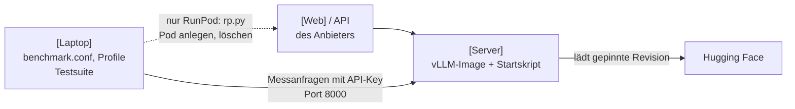

# Anleitung: Modelle messen

Schritt für Schritt vom leeren Rechner bis zur Vergleichstabelle. Jeder Schritt sagt, **wo** er passiert und **was dabei geschieht**.

**So ist die Anleitung aufgebaut:**
1. **Hier** stehen die Teile, die für jeden GPU-Server gleich sind: einrichten (Teil 1), Modell pinnen (Teil 2), messen (Teil 3), Ergebnisse (Teil 4).
2. **Den GPU-Server starten und wieder abbauen** beschreibt je ein eigenes Dokument pro Anbieter – siehe [GPU-Server wählen](#gpu-server-wählen).

## Die drei Orte

| Kürzel | Ort | Was dort passiert |
|---|---|---|
| **[Laptop]** | Terminal auf deinem Steuerrechner (Laptop, PC mit WSL, Server), im Ordner `SwarmLLM_Benchmark` | Du tippst alle Befehle hier. Hier liegen `benchmark.conf`, Profile und Ergebnisse. |
| **[Web]** | Weboberfläche des Anbieters (RunPod, Google Cloud, Vast.ai) | Konto, Ausgabenlimit, Zugangsdaten; bei Google Cloud und Vast.ai auch den Server anlegen. Bei RunPod legt `rp.py` den Pod an – dort nichts von Hand. |
| **[Server]** | der GPU-Server (bei RunPod „Pod“, sonst VM, Instanz oder eigener Rechner) | Hier läuft vLLM im Container. Das Startskript prüft die Hardware, lädt das Modell und startet vLLM von selbst. |



**Wichtig:** vLLM musst du nirgends installieren. Jeder Server startet direkt mit dem fertigen vLLM-Image aus dem Profil – bei Qwen das offizielle `vllm/vllm-openai`, bei GLM das gepatchte vLLM von Local Inference Lab („Karmic Kraken“).

## Die Skripte im Überblick

Zwei Hauptwerkzeuge, beide startest du auf dem **[Laptop]**:

| Skript | Aufgabe | Wann |
|---|---|---|
| `runpod/rp.py` | **GPU-Server steuern:** Pod anlegen, warten, prüfen, löschen, Kosten anzeigen | nur beim RunPod-Weg |
| `python3 -m bench` (Ordner `bench/`) | **Messen:** die Testsuite mit allen Blöcken, Ergebnissen und Auswertung | bei jedem Weg |

`rp.py` stellt nur den Server bereit – gemessen wird mit `bench`. Dazu Hilfsskripte:

| Skript | Aufgabe | Wo es läuft |
|---|---|---|
| `profiles/pin.py` | Modell-Revision und Image-Digest ins Profil eintragen | [Laptop], einmal pro Modell |
| `server/start-im-container.sh` | Host prüfen, Modell laden, vLLM starten | im Container auf dem [Server], automatisch – du rufst es nie selbst auf |
| `server/lokal-starten.sh` | startet den Container mit dem Startskript per `docker run` | auf dem [Server], bei Google Cloud und eigenem Server |
| `server/im-container-starten.sh` | startet das Startskript direkt im schon laufenden Container und auf Vast.ai den Watchdog | auf dem [Server], bei Vast.ai |
| `server/vast-watchdog.sh` | Auto-Stopp auf Vast.ai: Die Instanz löscht sich nach Ablauf selbst; anzeigen oder verlängern | auf dem [Server], bei Vast.ai |

Ein Lauf als Kette:
- **RunPod:** `pin.py` (einmal) → `rp.py up` → `rp.py warten` → `rp.py check` → `bench run alle` → `rp.py down`
- **Google Cloud, eigener Server:** `pin.py` (einmal) → VM bereitstellen → `lokal-starten.sh` → `bench run alle` → `lokal-starten.sh … stopp` bzw. VM löschen
- **Vast.ai:** `pin.py` (einmal) → Instanz mit vLLM-Image anlegen → `im-container-starten.sh` (startet auch den Watchdog) → `bench run alle` → Instanz löschen

## GPU-Server wählen

| Anbieter | Anleitung | Wofür | Hardware | Auto-Stopp |
|---|---|---|---|---|
| **RunPod** | [anleitung/runpod.md](anleitung/runpod.md) | Modelle komplett im VRAM (Qwen, GLM-5.3-Flash) | RTX PRO 6000, CPU nicht wählbar | Watchdog von `rp.py` auf dem Laptop |
| **Google Cloud G4** | [anleitung/google-cloud.md](anleitung/google-cloud.md) | wenn die CPU zählt (GLM-5.3 Q3, DeepSeek V4.1 Flash) | 2× RTX PRO 6000 + AMD EPYC Turin | maximale VM-Laufzeit |
| **Vast.ai** | [anleitung/vast-ai.md](anleitung/vast-ai.md) | Max-Q-Karten wie der Zielserver | CPU vor dem Mieten sichtbar | Watchdog in der Instanz löscht sie selbst |
| **Eigener Server** | [anleitung/eigener-server.md](anleitung/eigener-server.md) | endgültige Messung auf der Zielhardware | EPYC 9745 + 2× Max-Q | nicht nötig |

Bei jedem gemieteten Server gilt: **beim Anbieter ein Ausgabenlimit setzen** – die Skripte zeigen Kosten nur an.

---

## Teil 1 – Einmalig einrichten (kostenlos, für jeden Weg)

Diese Schritte brauchst du immer – egal ob RunPod, Google Cloud, Vast.ai oder eigener Server. Was nur für einen Anbieter nötig ist, steht in dessen eigenem Dokument.

### 1.1 Hugging-Face-Token [Web]

Bei Hugging Face unter **Settings → Access Tokens** einen Read-Token anlegen und kopieren.

### 1.2 Steuerrechner vorbereiten [Laptop]

Auf Windows in **WSL2 mit Ubuntu**, auf Linux oder macOS direkt im Terminal:

```bash
python3 --version                  # mindestens 3.11
sudo apt install -y git openssl    # Ubuntu/WSL; macOS hat beides meist schon
git clone https://github.com/Kalavera1/SwarmLLM_Benchmark.git
cd SwarmLLM_Benchmark
```

Optional für die ABAP-Syntaxprüfung: Node.js (`sudo apt install -y nodejs npm`). Ohne Node wird ABAP nur nach Kriterien bewertet.

### 1.3 Werte eintragen [Laptop]

```bash
cp benchmark.conf.example benchmark.conf
chmod 600 benchmark.conf           # nur du darfst die Datei lesen
nano benchmark.conf                # HF_TOKEN eintragen
```

Die Kommentare in der Datei erklären jeden Wert. `benchmark.conf` kommt nie ins Repo.

#### Der vLLM-Key (`VLLM_API_KEY`) – wann du ihn brauchst

Der vLLM-Key schützt den GPU-Server: Ohne ihn wäre vLLM offen im Internet erreichbar, und jeder könnte auf deine Kosten rechnen (Regel 8).

| Weg | Was du tun musst |
|---|---|
| **RunPod** mit `rp.py` | **Nichts.** `rp.py` erzeugt für jeden Pod einen eigenen Key und gibt ihn der Testsuite automatisch weiter. |
| **Vast.ai, Google Cloud, eigener Server** | **Wichtig:** Key einmal erzeugen. Derselbe Key muss auf dem Laptop **und** auf dem GPU-Server in `benchmark.conf` stehen, sonst antwortet der Server mit HTTP 401. |

Key erzeugen und direkt eintragen, ohne Kopieren:

```bash
sed -i "s/^VLLM_API_KEY=.*/VLLM_API_KEY=$(openssl rand -hex 24)/" benchmark.conf
grep -c '^VLLM_API_KEY=.\{48\}$' benchmark.conf    # Kontrolle: muss 1 ausgeben
```

Auf den GPU-Server kommt der Key, indem du dort dieselbe Zeile in dessen `benchmark.conf` einträgst – wie, steht in der Anleitung des Anbieters. Den Key nie per Chat, Ticket oder E-Mail weitergeben.

#### Ausblick: Schlüssel im späteren Betrieb mit LiteLLM

Für die Messungen reicht der vLLM-Key. Kommt später LiteLLM als Gateway für OpenWebUI und weitere Nutzer dazu (`chat-stack/`), gibt es mehrere Schlüssel mit getrennten Aufgaben:

| Schlüssel | Wofür | Wichtig |
|---|---|---|
| `VLLM_API_KEY` | LiteLLM → vLLM | kennt nur LiteLLM, kein Nutzer |
| `LITELLM_MASTER_KEY` | Admin-Zugang zu LiteLLM, erzeugt weitere Keys | muss mit `sk-` beginnen; nur für Admins |
| `LITELLM_SALT_KEY` | verschlüsselt in der Datenbank gespeicherte Zugangsdaten (z. B. den vLLM-Key) | **vor dem ersten Modell setzen und danach nie ändern** – sonst sind die gespeicherten Daten nicht mehr lesbar. Ohne eigenen Salt-Key nimmt LiteLLM den Master-Key, dann darf auch der nie geändert werden |
| Virtuelle Keys | je Nutzer, Team oder Anwendung, mit Budget und Modellfreigaben | erzeugt per Master-Key; braucht eine PostgreSQL-Datenbank |

Quellen: LiteLLM-Doku zu [Verschlüsselung und Salt-Key](https://docs.litellm.ai/docs/proxy/security_encryption_faq) und [virtuellen Keys](https://docs.litellm.ai/docs/proxy/virtual_keys). Der heutige `chat-stack/` nutzt nur den Master-Key; Salt-Key, Datenbank und virtuelle Keys kommen erst mit dem Betrieb dazu.

### 1.4 Selbsttest ohne GPU [Laptop]

```bash
python3 -m unittest discover -s bench/tests -t .
```

**Was passiert:** Die Testsuite läuft gegen einen eingebauten Mock-Server. Kostet nichts und zeigt, dass Python und Repo in Ordnung sind.

---

## Teil 2 – Modell vorbereiten (kostenlos, einmal pro Modell)

Regel 4: Gestartet wird nur eine feste Modell-Revision und ein festes Image. Das trägt `pin.py` ins Profil ein. Es braucht nur Internet, kein Docker.

### 2.1 Probelauf [Laptop]

```bash
python3 profiles/pin.py qwen38-27b --trocken
```

**Was passiert:** Das Skript holt die aktuelle Revision von Hugging Face und den Image-Digest direkt von der Registry (Docker Hub bzw. ghcr.io) und **zeigt nur an**, was es eintragen würde. Das Profil bleibt unverändert.

### 2.2 Pinnen [Laptop]

```bash
python3 profiles/pin.py qwen38-27b
git diff profiles/                 # prüfen, was eingetragen wurde
```

**Was passiert:** `MODEL_ID`, `MODEL_REVISION`, `MODELL_GROESSE_GB` und `VLLM_IMAGE` (mit `@sha256:…`) landen in `profiles/qwen38-27b/profile.env`. Danach committen und als Pull Request einreichen, damit der Stand versioniert ist.

Nur Modell oder nur Image: `--nur-modell` bzw. `--nur-image`.

---

## Teil 3 – Messen [Laptop]

**Voraussetzung:** Der GPU-Server läuft und ist geprüft – nach der Anleitung deines Anbieters (siehe [GPU-Server wählen](#gpu-server-wählen)).

```bash
python3 -m bench run alle --profil qwen38-27b      # Stufe "schnell", ca. 45–60 Min.
```

**Woher die Testsuite weiß, wohin sie misst:**
- **RunPod:** automatisch aus `runpod/.aktueller-pod.json` (Adresse und Key des Pods)
- **alle anderen:** aus `benchmark.conf` – `BENCH_ZIEL_URL=http://<adresse>:<port>/v1` und derselbe `VLLM_API_KEY` wie auf dem Server; `BENCH_KOSTEN_PRO_STUNDE` mit dem Preis, damit jedes Ergebnis seine Kosten ausweist

**Was passiert:**
- zuerst `integration` und `waechter`: Liefert das Modell Unsinn, bricht der Lauf ab, bevor teure Blöcke Zeit kosten
- dann Prefill (bis 500k), Decode, Nadeltest, Agent, Bilder, Lastmix (bis 30 Nutzer), Rechnen, ABAP
- pro Block ein Ergebnis mit Metadaten und Kosten unter `results/<profil>/`

Weitere Varianten:

```bash
python3 -m bench run alle --profil qwen38-27b --stufe voll     # nur wenn "schnell" gut aussah, 2–3 Std.
python3 -m bench run prefill nadel --profil qwen38-27b         # einzelne Blöcke nachmessen
```

Danach den Server abbauen – wie in der Anleitung deines Anbieters.

---

## Teil 4 – Ergebnisse [Laptop]

```bash
python3 -m bench auswertung --speichern    # Vergleichstabelle -> results/zusammenfassung.md
git add results/ && git commit -m "Ergebnisse qwen38-27b, Stufe schnell"
```

Als Pull Request einreichen. Die Rohdaten jeder Anfrage liegen in `results/raw/` und bleiben lokal.

---

## Reihenfolge der Modelle

Getestet wird vom billigen Referenzmodell zu den großen (Rangfolge nach Wichtigkeit: siehe README):

1. `qwen38-27b` – klein und billig, prüft die ganze Kette (RunPod)
2. `glm53-flash-fp4` (RunPod oder Vast.ai)
3. `deepseek-v41-flash` – Google Cloud G4 oder eigener Server, sobald das Profil fertig ist
4. `glm53-q3` – Google Cloud G4 oder eigener Server, sobald Runtime und Profil feststehen; ohne Bilder (GLM-5.3 nimmt nur Text)

## Wenn etwas schiefgeht

| Problem | Lösung |
|---|---|
| `kein API-Key gefunden` | `VLLM_API_KEY` in `benchmark.conf` fehlt (nicht bei RunPod) |
| `Profil nicht gepinnt` | Teil 2 |
| `pin.py`: Hugging Face antwortet mit 401/403/404 | Repo-Name im Profil oder `HF_TOKEN` prüfen; manche Modelle muss man auf Hugging Face erst freischalten |
| Testsuite meldet HTTP 401 | Laptop und Server nutzen verschiedene `VLLM_API_KEY` (siehe 1.3) |
| Keine Verbindung zum Server | Port-Freigabe bzw. Firewall beim Anbieter prüfen |
| Anbieter-spezifische Fehler | im Abschnitt „Wenn etwas schiefgeht“ der jeweiligen Anbieter-Anleitung |
