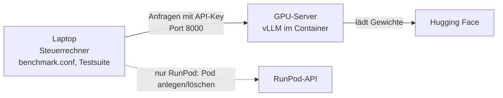

# Anleitung: Messläufe vom Laptop aus

Schritt für Schritt vom leeren Laptop bis zur Vergleichstabelle. Alle eigenen Werte stehen in **einer** Datei: `benchmark.conf`.

## Was wo läuft



- **Laptop (Steuerrechner):** hat die Zugangsdaten, startet und beendet GPU-Server, führt die Testsuite aus und speichert die Ergebnisse. Braucht keine GPU.
- **GPU-Server:** führt nur vLLM aus. Das Startskript im Container prüft zuerst die Hardware (P2P, CPU, RAM-Bandbreite, Power-Limit) und lädt dann das Modell.

> **Wichtig:** Der Watchdog, der einen RunPod-Pod nach Ablauf der Zeit löscht, läuft auf dem Laptop. **Laptop während eines Laufs nicht zuklappen und nicht in den Ruhezustand schicken.** Im Zweifel den Server über die Weboberfläche des Anbieters löschen.

## 1. Laptop einrichten (einmalig)

Auf Windows in **WSL2 mit Ubuntu**, auf Linux oder macOS direkt im Terminal:

```bash
python3 --version                  # mindestens 3.11
sudo apt install -y git openssl    # Ubuntu/WSL; macOS hat beides meist schon
git clone https://github.com/Kalavera1/SwarmLLM_Benchmark.git
cd SwarmLLM_Benchmark
```

Optional für die ABAP-Syntaxprüfung: Node.js (`sudo apt install -y nodejs npm`). Ohne Node wird ABAP nur nach Kriterien bewertet.

## 2. Werte eintragen (einmalig)

```bash
cp benchmark.conf.example benchmark.conf
openssl rand -hex 24               # Ergebnis als VLLM_API_KEY eintragen
nano benchmark.conf                # oder ein anderer Editor
```

Was in jedem Abschnitt steht, erklären die Kommentare in der Datei. Für den Anfang reichen `VLLM_API_KEY` und `HF_TOKEN`, für RunPod zusätzlich die RunPod-Werte.

Prüfen, ob alles läuft – ohne GPU, gegen den eingebauten Mock-Server:

```bash
python3 -m unittest discover -s bench/tests -t .
```

## 3. Modell pinnen (einmal pro Modell)

Regel 4: Gestartet wird nur eine feste Modell-Revision und ein festes Image. Braucht Internet; für den Image-Digest außerdem Docker.

```bash
python3 profiles/pin.py qwen38-27b
git diff profiles/                 # prüfen, committen, als Pull Request einreichen
```

**Ohne Docker auf dem Laptop:** Modell mit `python3 profiles/pin.py qwen38-27b --nur-modell` pinnen und den Image-Digest auf dem GPU-Server ermitteln:
`docker buildx imagetools inspect vllm/vllm-openai:v0.30.0` → den `Digest` als `VLLM_IMAGE=vllm/vllm-openai@sha256:…` ins Profil eintragen.

## 4. GPU-Server starten – einen Weg wählen

| Weg | Wann | Hardware |
|---|---|---|
| **A: RunPod** (automatisch) | Qwen und GLM – Modelle komplett im VRAM | RTX PRO 6000, CPU nicht wählbar |
| **B: Google Cloud G4** | DeepSeek V4.1 Flash und alles, wo die CPU zählt | 2× RTX PRO 6000 + AMD EPYC Turin |
| **C: Eigener Server** | endgültige Messung auf der Zielhardware | EPYC 9745 + 2× Max-Q |

### Weg A: RunPod

```bash
python3 runpod/rp.py gpus                       # einmalig: ID als RUNPOD_GPU_ID eintragen
python3 runpod/rp.py up qwen38-27b --trocken    # zeigt Anfrage und Kosten, legt nichts an
python3 runpod/rp.py up qwen38-27b              # fragt nach "ja", startet den Watchdog
python3 runpod/rp.py warten                     # Download und Laden, 10–30 Min.
python3 runpod/rp.py check                      # Host und Server prüfen
```

Schlägt `check` fehl (kein P2P, zu wenig RAM): sofort `python3 runpod/rp.py down` und neu anlegen. Weiter mit Schritt 5, danach Schritt 6.

### Weg B: Google Cloud G4 (EPYC Turin)

`g4-standard-96`: 2× RTX PRO 6000, 96 vCPU AMD Turin (EPYC 9005, dieselbe Generation wie der EPYC 9745), 360 GB RAM. Preis laut gcloud-compute.com (Stand 15.11.2026) in Europa ca. **4,10–4,60 $/h als Spot**, ca. 9,90 $/h regulär.

1. **Einmalig:** Google-Cloud-Projekt mit Abrechnung anlegen und unter *IAM → Kontingente* GPU-Kontingent für „NVIDIA RTX PRO 6000“ in einer Region beantragen (z. B. `europe-west4`). Die Freigabe kann Tage dauern.
2. **VM anlegen** (Konsole → Compute Engine → VM erstellen): Maschinentyp `g4-standard-96`, Bereitstellung *Spot*, Image mit NVIDIA-Treiber (z. B. „Deep Learning VM“; Docker und NVIDIA Container Toolkit nachinstallieren, falls sie fehlen), Bootlaufwerk 600 GB SSD. In der Firewall Port **8000** nur für die IP deines Laptops freigeben.
3. **Auf der VM** (per SSH aus der Konsole):
   ```bash
   git clone https://github.com/Kalavera1/SwarmLLM_Benchmark.git && cd SwarmLLM_Benchmark
   cp benchmark.conf.example benchmark.conf    # VLLM_API_KEY und HF_TOKEN wie auf dem Laptop
   server/lokal-starten.sh qwen38-27b
   docker logs -f swarmllm-qwen38-27b          # warten bis "bereit"
   curl -s localhost:8001/host.json            # CPU, RAM-Bandbreite, P2P
   ```
4. **Auf dem Laptop** in `benchmark.conf`: `BENCH_ZIEL_URL=http://<externe-IP>:8000/v1` und `BENCH_KOSTEN_PRO_STUNDE` mit dem Preis der VM. Weiter mit Schritt 5.
5. **Danach die VM löschen** (nicht nur anhalten – das Laufwerk kostet sonst weiter).

> Bei Google gibt es keinen Watchdog aus diesem Repo. Stattdessen der VM beim Anlegen eine **maximale Laufzeit mit automatischem Löschen** geben – unbedingt setzen. Per Kommandozeile sind das die Optionen `--max-run-duration=4h --instance-termination-action=DELETE`; in der Konsole heißt es „Laufzeit der VM begrenzen“.

### Weg C: Eigener Server

Wie Weg B, Schritt 3 und 4 – nur auf dem eigenen Server und ohne Kosten.

## 5. Messen

```bash
python3 -m bench run alle --profil qwen38-27b                  # Stufe schnell, ca. 45–60 Min.
python3 -m bench run alle --profil qwen38-27b --stufe voll     # nur wenn schnell gut aussah
python3 -m bench run prefill nadel --profil qwen38-27b         # einzelne Blöcke nachmessen
```

Bei `alle` laufen zuerst `integration` und `waechter`. Scheitert einer davon, bricht der Lauf ab, bevor teure Blöcke GPU-Zeit kosten.

## 6. Aufräumen

```bash
python3 runpod/rp.py down          # Weg A: Pod löschen, Kosten verbuchen
python3 runpod/rp.py budget        # was noch übrig ist
server/lokal-starten.sh qwen38-27b stopp   # Weg B/C: auf dem Server
```

Weg A: In RunPod unter *Billing* kontrollieren, dass nichts mehr läuft. Weg B: VM **löschen**.

## 7. Ergebnisse

```bash
python3 -m bench auswertung --speichern    # Vergleichstabelle -> results/zusammenfassung.md
git add results/ && git commit -m "Ergebnisse qwen38-27b, Stufe schnell"
```

Ergebnisse als Pull Request einreichen. Rohdaten jeder Anfrage liegen in `results/raw/` und bleiben lokal.

## Reihenfolge der Modelle

1. `qwen38-27b` – klein und billig, prüft die ganze Kette (Weg A)
2. `qwen38-flash-next-fp8` (Weg A)
3. `glm53-flash-fp4` (Weg A)
4. `deepseek-v41-flash` – sobald der Weg entschieden ist (Weg B oder C)

## Wenn etwas schiefgeht

| Problem | Lösung |
|---|---|
| `kein API-Key gefunden` | `VLLM_API_KEY` in `benchmark.conf` fehlt |
| `Profil nicht gepinnt` | Schritt 3 |
| `rp.py warten` zeigt `fehler: P2P …` | Host verwerfen: `rp.py down`, neu anlegen |
| Testsuite meldet HTTP 401 | Laptop und Server nutzen verschiedene `VLLM_API_KEY` |
| Keine Verbindung zu Port 8000 | Firewall/Port-Freigabe beim Anbieter prüfen |
| Laptop war zugeklappt | Beim Anbieter nachsehen, ob der Server noch läuft, und ihn löschen |
