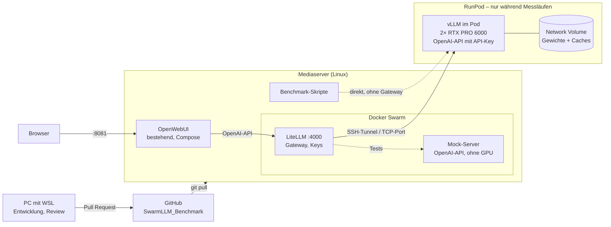

# SwarmLLM_Benchmark

Privates Testprojekt: große Open-Weight-Modelle mit vLLM auf **gemieteten 2× NVIDIA RTX PRO 6000 Blackwell** (je 96 GB, SM120, kein NVLink) betreiben, vergleichen und vermessen – mit **LiteLLM** als Gateway und **OpenWebUI** als Frontend.

## Ziel

- **Kontext:** mindestens 500.000, möglichst 1.000.000 Tokens pro Anfrage
- **Realistische Last:** ca. 30 Nutzer, davon ca. 4 mit Vibe Coding (lange, wachsende Kontexte), der Rest Chat über OpenWebUI
- **Kosten minimal:** GPU-Instanz läuft nur für Messläufe und wird danach sofort gelöscht

## Regeln

1. **Strikt isoliert. Kein Bezug zu anderen Stackprojekten.** Kein Code, keine Configs, keine Zugangsdaten, keine Actions-Runner von Konfliktparteien.
2. **Keine Secrets im Repo.** Zugangsdaten für Skripte nur in `.env` (steht in `.gitignore`, Vorlage: `.env.example`). Zugangsdaten für den lokalen Stack als Docker Secrets.
3. **Keine Gewichte, Caches oder Container-Layer im Repo.**
4. **Alles gepinnt.** Container-Images per Digest (`@sha256:…`), Checkpoints per Revision (Commit-Hash). Nie wandernde Tags wie `latest` oder `-beta`.
5. **Kein GPU-Lauf ohne Auto-Stopp.** Jeder Pod bekommt einen Watchdog, damit keiner vergessen wird.
6. **Ergebnisse sind nachvollziehbar.** Jede Messung speichert Datum, Image-Digest, Checkpoint-Revision, Startparameter und Hardware.
7. **Schrittweise.** Jede Phase endet mit einem Review, bevor die nächste beginnt (siehe [Roadmap](docs/roadmap.md)).
8. **Nie ein offener Endpunkt.** vLLM läuft immer mit `VLLM_API_KEY`. Jeder Pod-Check prüft, dass eine Anfrage ohne Key abgewiesen wird.

## Architektur



- **Durchgezogene Pfeile:** Betrieb. **Gestrichelte Pfeile:** Tests und Messungen.
- Der PC mit WSL läuft nicht dauerhaft. Er dient nur zum Entwickeln und Reviewen; betrieben wird alles vom Mediaserver aus.

- **Warum das vLLM-Image direkt als Pod-Image?** In RunPod-Pods ist kein eigenes Docker und kein Docker Compose möglich. Konfiguration läuft über Umgebungsvariablen und das Startkommando.
- **Warum auf dem Mediaserver?** Dort läuft die OpenWebUI, die tatsächlich genutzt wird, und der Rechner ist dauerhaft an. In WSL wäre LiteLLM für andere Rechner nur mit zusätzlicher Netzwerk-Einrichtung erreichbar (WSL2 hängt hinter eigenem NAT).
- **Warum LiteLLM als Gateway?** Die bestehende OpenWebUI bekommt einmalig LiteLLM als Verbindung. Pro Testlauf ändert sich nur das Ziel in LiteLLM (Mock, aktueller Pod, später andere Modelle) – OpenWebUI muss dafür nie umkonfiguriert oder neu gestartet werden. Zusätzlich verwaltet LiteLLM die Keys, sodass der vLLM-Key nie in OpenWebUI landet.
- **Warum nicht über den RunPod-HTTP-Proxy?** Er trennt stille Verbindungen nach ca. 2 Minuten. Ein kalter 1M-Prompt dauert auf dieser Hardware länger (siehe [Erfahrungen](docs/erfahrungen.md)).
- **Warum Docker Swarm?** Native Secrets, Healthchecks mit automatischem Neustart und ein Stack-File, das später auf weitere Nodes wachsen kann. Swarm umfasst nur den Mediaserver: Der RunPod-Pod kann kein Swarm-Node werden (kein Docker im Pod, kein UDP). Die bestehende OpenWebUI bleibt unverändert in Compose.

## Modell-Kandidaten

| Modell | Runtime | Checkpoint | Status |
|---|---|---|---|
| DeepSeek V4 Flash | Karmic Kraken (`ghcr.io/local-inference-lab/vllm`), per Digest gepinnt | wird in Phase 4 festgelegt | geplant |
| GLM-5.3-Flash | Runtime von T.J. Purtell (`tpurtell/glm-5.3-flash-ext3-2x-rtx`), Profil `k3` | EXL3 K3, Revision wird in Phase 6 gepinnt | geplant |
| Qwen3.8-Flash-Next | offen | `nvidia/Qwen3.8-Flash-Next-FP4-Local` | später |

Warum diese Auswahl: siehe [Entscheidungslog](docs/entscheidungen.md).

## Lizenzen beachten

- **DFlash2-Drafter** (`incoai/GLM-5.3-Flash-DFlash2`): CC BY-NC-ND 4.0, nur Forschung und Evaluation. Für diese Tests in Ordnung, für produktiven Einsatz nur mit Lizenz von Inco AI. Deshalb wird GLM zusätzlich ohne Drafter bzw. im MTP-Modus gemessen.
- **GLM-EXL3-Checkpoint:** Lizenz auf der Model Card vor dem Download prüfen (Phase 6).
- **Karmic Kraken:** Community-Projekt, als Pre-Release markiert.

## Struktur

Ordner entstehen erst in der Phase, in der sie gebraucht werden.

```
.
├── README.md
├── CLAUDE.md           Arbeitsregeln für Claude-Sitzungen
├── .env.example        Vorlage für Zugangsdaten (echte Werte nur in .env)
├── .github/workflows/  CI: Secret-Scan, Pin-Prüfung, Linter
├── ci/                 Prüfskripte der CI mit Unit-Tests
├── docs/
│   ├── roadmap.md      Phasen, Ergebnisse, Review-Kriterien
│   ├── entscheidungen.md
│   └── erfahrungen.md  Lehren aus früheren Tests
├── local/              Phase 1: Swarm-Stack mit LiteLLM + Mock-Server (Anleitung: local/README.md)
├── bench/              Phase 2: Testsuite (V-Modell), blockweise startbar
├── runpod/             Phase 3–4: Pod anlegen, prüfen, löschen
├── profiles/           Phase 4+: ein Ordner pro Modell
└── results/            Messergebnisse (JSON + Zusammenfassung)
```
