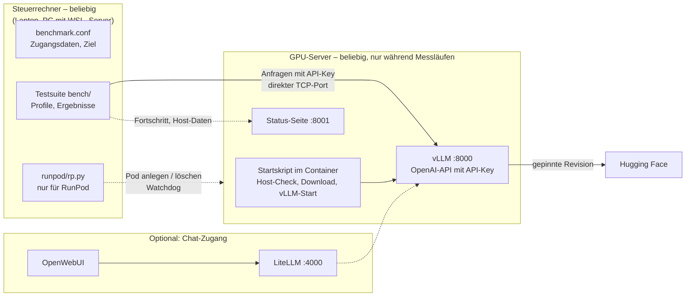

# SwarmLLM_Benchmark

Testprojekt: große Open-Weight-Modelle mit vLLM auf **2× NVIDIA RTX PRO 6000 Blackwell** (je 96 GB, SM120, kein NVLink) betreiben, vergleichen und vermessen – gemietet in der Cloud oder auf einem eigenen Server.

**Maschinenunabhängig:** Gesteuert wird von einem beliebigen Rechner mit Python 3.11 (Laptop, PC mit WSL, Server). Gemessen wird gegen einen beliebigen GPU-Server mit Docker oder einen RunPod-Pod. Alle eigenen Werte stehen in einer Datei, `benchmark.conf`.

**Loslegen:** [ANLEITUNG.md](ANLEITUNG.md) – Schritt für Schritt vom leeren Rechner bis zur Vergleichstabelle.

## Ziel

- **Kontext:** mindestens 500.000, möglichst 1.000.000 Tokens pro Anfrage
- **Realistische Last:** ca. 30 Nutzer, davon ca. 4 mit Vibe Coding (lange, wachsende Kontexte), der Rest Chat über OpenWebUI
- **Bildverständnis:** Das Modell soll Bilder verarbeiten können (Screenshots, Diagramme)
- **Agenten:** Das Modell soll als Arbeitsmodell für einen autonomen Agenten (Hermes Agent) taugen – zuverlässige Tool-Calls, mindestens 64k Kontext
- **Kosten minimal:** GPU-Instanz läuft nur für Messläufe und wird danach sofort gelöscht. Die Ausgabengrenze steht als Limit im Konto beim Anbieter

## Regeln

1. **Strikt isoliert. Kein Bezug zu anderen Stackprojekten.** Kein Code, keine Configs, keine Zugangsdaten, keine Actions-Runner von Konfliktparteien.
2. **Keine Secrets im Repo.** Zugangsdaten für Skripte nur in `benchmark.conf` (steht in `.gitignore`, Vorlage: `benchmark.conf.example`). Zugangsdaten für den optionalen Chat-Stack als Docker Secrets.
3. **Keine Gewichte, Caches oder Container-Layer im Repo.**
4. **Alles gepinnt.** Container-Images per Digest (`@sha256:…`), Checkpoints per Revision (Commit-Hash). Nie wandernde Tags wie `latest` oder `-beta`.
5. **Kein GPU-Lauf ohne Auto-Stopp.** RunPod-Pods bekommen einen Watchdog auf dem Steuerrechner, Vast.ai-Instanzen einen Watchdog, der sie von innen löscht, Cloud-VMs eine maximale Laufzeit mit automatischem Löschen – damit keiner vergessen wird.
6. **Ergebnisse sind nachvollziehbar.** Jede Messung speichert Datum, Image-Digest, Checkpoint-Revision, Startparameter und Hardware.
7. **Schrittweise.** Jede Phase endet mit einem Review, bevor die nächste beginnt (siehe [Roadmap](docs/roadmap.md)).
8. **Nie ein offener Endpunkt.** vLLM läuft immer mit `VLLM_API_KEY`. Jeder Pod-Check prüft, dass eine Anfrage ohne Key abgewiesen wird.

## Architektur



**Steuerrechner** – jeder Rechner mit Python 3.11 und `git`, keine GPU nötig. Er hält `benchmark.conf`, startet und beendet GPU-Server, führt die Testsuite aus und speichert die Ergebnisse. Nur bei RunPod läuft hier auch der Watchdog; dann muss der Rechner während des Laufs an bleiben.

**GPU-Server** – überall, wo das vLLM-Image mit zwei GPUs läuft. Das Startskript `server/start-im-container.sh` ist überall dasselbe, damit Messungen vergleichbar bleiben:

| Weg | Start | Wofür |
|---|---|---|
| RunPod | `python3 runpod/rp.py up <profil>` (automatisch, mit Kostenanzeige und Watchdog) | Modelle komplett im VRAM (Qwen, GLM-5.3-Flash) |
| Google Cloud G4 | VM anlegen, dann `server/lokal-starten.sh <profil>` | wenn die CPU zählt: AMD EPYC Turin wie der Zielserver |
| Vast.ai | Instanz mit vLLM-Image anlegen, dann `server/im-container-starten.sh <profil>` (mit Watchdog) | Max-Q-Karten wie der Zielserver; CPU-Modell vor dem Mieten sichtbar |
| Eigener Server | `server/lokal-starten.sh <profil>` | endgültige Messung auf der Zielhardware |

**Optional: Chat-Zugang** – OpenWebUI mit LiteLLM als Gateway (Ordner `chat-stack/`, Docker-Swarm-Stack, auf einem beliebigen Linux-Rechner mit Docker), um ein Modell während eines Laufs selbst auszuprobieren. Für die Messungen nicht nötig; die Testsuite misst direkt gegen vLLM.

Warum so:
- **Das vLLM-Image direkt als Container**, nicht von Hand installiert: Die Handinstallation scheiterte beim B300-Test an CUDA- und PyTorch-Versionen. In RunPod-Pods gibt es außerdem kein eigenes Docker.
- **Direkter TCP-Port statt RunPod-HTTP-Proxy:** Der Proxy trennt stille Verbindungen nach ca. 2 Minuten. Ein kalter 1M-Prompt dauert auf dieser Hardware länger (siehe [Erfahrungen](docs/erfahrungen.md)).
- **Kein Network Volume:** Volumes gibt es bei RunPod nur in der Secure Cloud und kosten auch ohne laufenden Pod. Jeder Pod lädt die gepinnte Revision selbst (siehe [Entscheidungslog](docs/entscheidungen.md)).
- **LiteLLM vor OpenWebUI:** OpenWebUI bekommt einmalig LiteLLM als Verbindung. Pro Lauf ändert sich nur das Ziel in LiteLLM, und der vLLM-Key landet nie in OpenWebUI. Messungen gehen bewusst nicht über LiteLLM, damit kein Gateway-Cache die Zahlen schönt.

## Zielhardware

1× AMD EPYC 9745 (128 Kerne, Zen 5c, 12 Kanäle DDR5) und 2× NVIDIA RTX PRO 6000 Blackwell **Max-Q** Workstation Edition (je 96 GB, 300 W, PCIe Gen5). Messungen auf anderer Hardware (Cloud) speichern Power-Limit, CPU und RAM-Bandbreite, damit sie sich einordnen lassen.

## Modell-Kandidaten

Getestet wird **nur mit 2 Karten** (2× RTX PRO 6000, 192 GB VRAM). Stand: 17.11.2026.

### Rangfolge nach Wichtigkeit

| Rang | Modell | Bilder | Passt in 2× 96 GB? | Weg | Checkpoint | Phase |
|---|---|---|---|---|---|---|
| **1** | **GLM-5.3** (≈ 753B) in **Q3** | **nein** – nur Text | nein – Experten teils im Arbeitsspeicher | llama.cpp oder KTransformers mit CPU-Experten | Unsloth `UD-Q3_K_XL` (≈ 343 GB) | 8 |
| **2** | **DeepSeek V4.1 Flash** (763B) | ja | nein – Experten teils auf der CPU, Engram-Tabellen auf der NVMe | gepatchtes vLLM mit CPU-Experten (Rezept theogravity) | `diffbot/DeepSeek-V4.1-Flash-EXL3-3bpw-2x-RTX-PRO-6000` (≈ 322 GiB) | 7 |
| 3 | GLM-5.3-Flash (320B, 18B aktiv) | ja | ja | vLLM-Container von Local Inference Lab | `nvidia/GLM-5.3-Flash-FP4-Local` (≈ 166 GiB, von NVIDIA auf 2× RTX PRO 6000 validiert) | 6 |
| 4 | Qwen3.8-27B (dense) – **Referenz** | ja | ja, sogar auf einer Karte | vLLM (offizielles Recipe) | `nvidia/Qwen3.8-27B-NVFP4` | 4 |
| – | GLM-5.3-Flash über Purtell-Runtime | ja | ja | `tpurtell/glm-5.3-flash-ext3-2x-rtx`, Profil `k3` | EXL3 K3 (≈ 127 GiB) | optional |
| – | DeepSeek V4 Flash (284B, 13B aktiv) | **nein** | ja, mit SM120-Patches | Karmic Kraken (`ghcr.io/local-inference-lab/vllm`) | `deepseek-ai/DeepSeek-V4-Flash-0731` | optional |

**Testreihenfolge ist umgekehrt:** zuerst Rang 4 (Qwen3.8-27B, billig, prüft die ganze Kette), dann Rang 3, zuletzt die beiden großen Modelle mit CPU-Auslagerung – sie brauchen einen Host mit viel und schnellem Arbeitsspeicher (siehe unten).

**Bilder:** GLM-5.3 nimmt laut Z.ai nur Text an; sein Block `bilder` entfällt. Alle anderen Modelle der Rangfolge werden mit Bildern gemessen.

### Was die beiden wichtigsten Modelle verlangen

Beide sind größer als 192 GB VRAM. Ein Teil der Experten läuft deshalb auf der CPU, und das Tempo hängt an CPU, Speicherbandbreite und Menge des Arbeitsspeichers – nicht nur an den GPUs.

| | GLM-5.3 Q3 | DeepSeek V4.1 Flash |
|---|---|---|
| Gewichte | ≈ 343 GB | ≈ 322 GiB |
| Arbeitsspeicher im Host | ≥ 256 GB, besser 384 GB (abgeleitet: Gewichte minus VRAM plus Reserve) | ≈ 250 GB laut Rezept |
| Gemessen auf 2× RTX PRO 6000 (Fremdquelle) | nur die kleinere 2-Bit-Variante: 11–12 tok/s, Einlesen ≈ 83 tok/s (llama.cpp, Xeon, 128 GB RAM) | ≈ 250 tok/s, 505k Kontext, erstes Token nach 41,6 s (Rezept theogravity, Threadripper PRO, 246 GiB RAM) |
| Risiko für 500k Kontext | **hoch:** bei ≈ 83 tok/s Einlesen dauert ein 500k-Prompt über eine Stunde; KTransformers liest auf der GPU ein und könnte deutlich schneller sein – für GLM-5.3 auf 2 Karten gibt es dazu noch keine Messung | gering, laut Rezept gemessen |

Für den Zielserver (EPYC 9745) heißt das: **alle 12 Speicherkanäle bestücken und mindestens 384 GB RAM** einplanen, damit beide Modelle laufen.

Quellen und Begründung: [Entscheidungslog](docs/entscheidungen.md).

## Lizenzen beachten

- **DFlash2-Drafter** (`incoai/GLM-5.3-Flash-DFlash2`): CC BY-NC-ND 4.0, nur Forschung und Evaluation. Für diese Tests in Ordnung, für produktiven Einsatz nur mit Lizenz von Inco AI. Deshalb wird GLM zusätzlich ohne Drafter bzw. im MTP-Modus gemessen.
- **GLM-EXL3-Checkpoint:** Lizenz auf der Model Card vor dem Download prüfen (Phase 6).
- **Karmic Kraken:** Community-Projekt, als Pre-Release markiert.

## Struktur

```
.
├── README.md
├── ANLEITUNG.md        Schritt für Schritt: Messläufe vom Laptop aus (gemeinsame Teile)
├── anleitung/          GPU-Server starten und abbauen, je Anbieter: RunPod, Google Cloud, Vast.ai, eigener Server
├── benchmark.conf.example  alle eigenen Werte (Kopie benchmark.conf, nicht im Repo)
├── CLAUDE.md           Arbeitsregeln für Claude-Sitzungen
├── .github/workflows/  CI: Secret-Scan, Pin-Prüfung, Linter
├── ci/                 Prüfskripte der CI mit Unit-Tests
├── docs/
│   ├── roadmap.md      Phasen, Ergebnisse, Review-Kriterien
│   ├── entscheidungen.md
│   └── erfahrungen.md  Lehren aus früheren Tests
├── chat-stack/         optional: Chat-Zugang mit LiteLLM + Mock-Server (Anleitung: chat-stack/README.md)
├── bench/              Testsuite (V-Modell), blockweise startbar (Anleitung: bench/README.md)
├── runpod/             RunPod automatisch: Pod anlegen, prüfen, löschen (technische Referenz: runpod/README.md)
├── server/             Startskript im Container (alle Wege); Start per docker run oder direkt im Container; Watchdog für Vast.ai
├── profiles/           ein Ordner pro Modell (Anleitung: profiles/README.md)
├── results/            Messergebnisse (JSON + Zusammenfassung), Messreihe v1
└── archiv/             frühere Testläufe, unverändert, mit Steckbrief (Messreihe v0)
```
