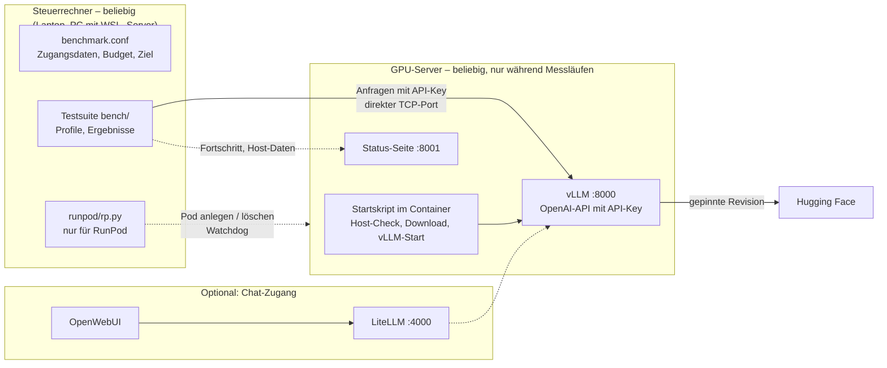

# SwarmLLM_Benchmark

Testprojekt: große Open-Weight-Modelle mit vLLM auf **2× NVIDIA RTX PRO 6000 Blackwell** (je 96 GB, SM120, kein NVLink) betreiben, vergleichen und vermessen – gemietet in der Cloud oder auf einem eigenen Server.

**Maschinenunabhängig:** Gesteuert wird von einem beliebigen Rechner mit Python 3.11 (Laptop, PC mit WSL, Server). Gemessen wird gegen einen beliebigen GPU-Server mit Docker oder einen RunPod-Pod. Alle eigenen Werte stehen in einer Datei, `benchmark.conf`.

**Loslegen:** [ANLEITUNG.md](ANLEITUNG.md) – Schritt für Schritt vom leeren Rechner bis zur Vergleichstabelle.

## Ziel

- **Kontext:** mindestens 500.000, möglichst 1.000.000 Tokens pro Anfrage
- **Realistische Last:** ca. 30 Nutzer, davon ca. 4 mit Vibe Coding (lange, wachsende Kontexte), der Rest Chat über OpenWebUI
- **Bildverständnis:** Das Modell soll Bilder verarbeiten können (Screenshots, Diagramme)
- **Agenten:** Das Modell soll als Arbeitsmodell für einen autonomen Agenten (Hermes Agent) taugen – zuverlässige Tool-Calls, mindestens 64k Kontext
- **Kosten minimal:** GPU-Instanz läuft nur für Messläufe und wird danach sofort gelöscht. Budget für die erste Runde: 100 $

## Regeln

1. **Strikt isoliert. Kein Bezug zu anderen Stackprojekten.** Kein Code, keine Configs, keine Zugangsdaten, keine Actions-Runner von Konfliktparteien.
2. **Keine Secrets im Repo.** Zugangsdaten für Skripte nur in `benchmark.conf` (steht in `.gitignore`, Vorlage: `benchmark.conf.example`). Zugangsdaten für den optionalen Chat-Stack als Docker Secrets.
3. **Keine Gewichte, Caches oder Container-Layer im Repo.**
4. **Alles gepinnt.** Container-Images per Digest (`@sha256:…`), Checkpoints per Revision (Commit-Hash). Nie wandernde Tags wie `latest` oder `-beta`.
5. **Kein GPU-Lauf ohne Auto-Stopp.** RunPod-Pods bekommen einen Watchdog, Cloud-VMs eine maximale Laufzeit mit automatischem Löschen – damit keiner vergessen wird.
6. **Ergebnisse sind nachvollziehbar.** Jede Messung speichert Datum, Image-Digest, Checkpoint-Revision, Startparameter und Hardware.
7. **Schrittweise.** Jede Phase endet mit einem Review, bevor die nächste beginnt (siehe [Roadmap](docs/roadmap.md)).
8. **Nie ein offener Endpunkt.** vLLM läuft immer mit `VLLM_API_KEY`. Jeder Pod-Check prüft, dass eine Anfrage ohne Key abgewiesen wird.

## Architektur



**Steuerrechner** – jeder Rechner mit Python 3.11 und `git`, keine GPU nötig. Er hält `benchmark.conf`, startet und beendet GPU-Server, führt die Testsuite aus und speichert die Ergebnisse. Nur bei RunPod läuft hier auch der Watchdog; dann muss der Rechner während des Laufs an bleiben.

**GPU-Server** – überall, wo das vLLM-Image mit zwei GPUs läuft. Das Startskript `server/start-im-container.sh` ist überall dasselbe, damit Messungen vergleichbar bleiben:

| Weg | Start | Wofür |
|---|---|---|
| RunPod | `python3 runpod/rp.py up <profil>` (automatisch, mit Budget und Watchdog) | Modelle komplett im VRAM (Qwen, GLM) |
| Google Cloud G4 | VM anlegen, dann `server/lokal-starten.sh <profil>` | wenn die CPU zählt: AMD EPYC Turin wie der Zielserver |
| Vast.ai | Image und Startskript per Oberfläche | CPU-Modell vor dem Mieten sichtbar |
| Eigener Server | `server/lokal-starten.sh <profil>` | endgültige Messung auf der Zielhardware |

**Optional: Chat-Zugang** – OpenWebUI mit LiteLLM als Gateway (Ordner `local/`, Docker-Swarm-Stack), um ein Modell während eines Laufs selbst auszuprobieren. Für die Messungen nicht nötig; die Testsuite misst direkt gegen vLLM.

Warum so:
- **Das vLLM-Image direkt als Container**, nicht von Hand installiert: Die Handinstallation scheiterte beim B300-Test an CUDA- und PyTorch-Versionen. In RunPod-Pods gibt es außerdem kein eigenes Docker.
- **Direkter TCP-Port statt RunPod-HTTP-Proxy:** Der Proxy trennt stille Verbindungen nach ca. 2 Minuten. Ein kalter 1M-Prompt dauert auf dieser Hardware länger (siehe [Erfahrungen](docs/erfahrungen.md)).
- **Kein Network Volume:** Volumes gibt es bei RunPod nur in der Secure Cloud und kosten auch ohne laufenden Pod. Jeder Pod lädt die gepinnte Revision selbst (siehe [Entscheidungslog](docs/entscheidungen.md)).
- **LiteLLM vor OpenWebUI:** OpenWebUI bekommt einmalig LiteLLM als Verbindung. Pro Lauf ändert sich nur das Ziel in LiteLLM, und der vLLM-Key landet nie in OpenWebUI. Messungen gehen bewusst nicht über LiteLLM, damit kein Gateway-Cache die Zahlen schönt.

## Zielhardware

1× AMD EPYC 9745 (128 Kerne, Zen 5c, 12 Kanäle DDR5) und 2× NVIDIA RTX PRO 6000 Blackwell **Max-Q** Workstation Edition (je 96 GB, 300 W, PCIe Gen5). Messungen auf anderer Hardware (Cloud) speichern Power-Limit, CPU und RAM-Bandbreite, damit sie sich einordnen lassen.

## Modell-Kandidaten

Reihenfolge = Testreihenfolge. Stand: Recherche vom 16.11.2026.

| # | Modell | Bilder | Runtime | Checkpoint | Status |
|---|---|---|---|---|---|
| ★ | **DeepSeek V4.1 Flash** (763B, wichtigstes Modell) | ja | 2 Karten: gepatchtes vLLM mit CPU-Experten (Rezept theogravity), 4 Karten: Karmic Kraken `ds41-flash` | 2 Karten: `diffbot/DeepSeek-V4.1-Flash-EXL3-3bpw-2x-RTX-PRO-6000` (≈ 322 GiB), 4 Karten: `deepseek-ai/DeepSeek-V4.1-Flash` | Weg offen: eigener Server oder 4× RunPod |
| 0 | Qwen3.8-27B (Referenz, dense) | ja | vLLM (offizielles Recipe für RTX Pro 6000) | `nvidia/Qwen3.8-27B-NVFP4` | Phase 4: erster GPU-Test |
| 1 | Qwen3.8-Flash-Next (125B + 51B N-gram, 6B aktiv) | ja | vLLM ≥ 0.30 (Nightly) | `Qwen/Qwen3.8-Flash-Next-FP8`, N-gram-Tabelle im Host-RAM | Phase 5 |
| 2 | GLM-5.3-Flash (320B, 18B aktiv) | ja | vLLM-Container von Local Inference Lab | `nvidia/GLM-5.3-Flash-FP4-Local` (~166 GiB, von NVIDIA auf 2× RTX PRO 6000 validiert) | Phase 6 |
| 2b | GLM-5.3-Flash | ja | Runtime von T.J. Purtell (`tpurtell/glm-5.3-flash-ext3-2x-rtx`), Profil `k3` | EXL3 K3 (~127 GiB) | optional, nur bei Restbudget |
| 3 | DeepSeek V4 Flash (284B, 13B aktiv) | **nein** | Karmic Kraken (`ghcr.io/local-inference-lab/vllm`), SM120-Patches | `deepseek-ai/DeepSeek-V4-Flash-0731` | Phase 7, nur bei Restbudget |

**Passen nicht auf 2× 96 GB** (nur per API sinnvoll): GLM-5.3, Qwen3.5-397B. DeepSeek V4.1 Flash passt nur mit Auslagerung von Experten auf die CPU und der Engram-Tabellen auf die NVMe (siehe Entscheidungslog).

Warum diese Auswahl und Reihenfolge: siehe [Entscheidungslog](docs/entscheidungen.md).

## Lizenzen beachten

- **DFlash2-Drafter** (`incoai/GLM-5.3-Flash-DFlash2`): CC BY-NC-ND 4.0, nur Forschung und Evaluation. Für diese Tests in Ordnung, für produktiven Einsatz nur mit Lizenz von Inco AI. Deshalb wird GLM zusätzlich ohne Drafter bzw. im MTP-Modus gemessen.
- **GLM-EXL3-Checkpoint:** Lizenz auf der Model Card vor dem Download prüfen (Phase 6).
- **Karmic Kraken:** Community-Projekt, als Pre-Release markiert.

## Struktur

Ordner entstehen erst in der Phase, in der sie gebraucht werden.

```
.
├── README.md
├── ANLEITUNG.md        Schritt für Schritt: Messläufe vom Laptop aus
├── benchmark.conf.example  alle eigenen Werte (Kopie benchmark.conf, nicht im Repo)
├── CLAUDE.md           Arbeitsregeln für Claude-Sitzungen
├── .env.example        Vorlage nur für den optionalen Chat-Stack in local/
├── .github/workflows/  CI: Secret-Scan, Pin-Prüfung, Linter
├── ci/                 Prüfskripte der CI mit Unit-Tests
├── docs/
│   ├── roadmap.md      Phasen, Ergebnisse, Review-Kriterien
│   ├── entscheidungen.md
│   └── erfahrungen.md  Lehren aus früheren Tests
├── local/              optional: Chat-Stack mit LiteLLM + Mock-Server (Anleitung: local/README.md)
├── bench/              Phase 2: Testsuite (V-Modell), blockweise startbar
├── runpod/             RunPod automatisch: Pod anlegen, prüfen, löschen (Anleitung: runpod/README.md)
├── server/             Startskript im Container (alle Wege), docker run für eigene Server und Cloud-VMs
├── profiles/           Phase 4+: ein Ordner pro Modell
├── results/            Messergebnisse (JSON + Zusammenfassung), Messreihe v1
└── archiv/             frühere Testläufe, unverändert, mit Steckbrief (Messreihe v0)
```
