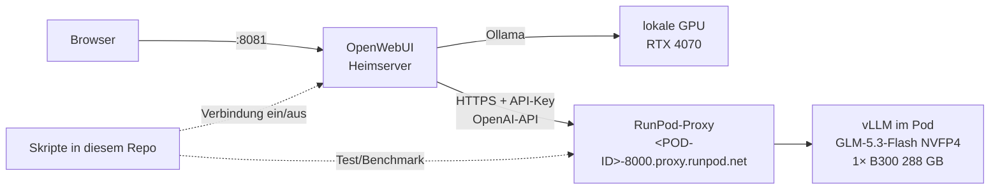

# benchmark_GLM53_runpod: GLM-5.3-Flash auf einer gemieteten B300 für OpenWebUI

Ein großes Sprachmodell (GLM-5.3-Flash, 321 Mrd. Parameter) stundenweise auf einer Cloud-GPU bei RunPod betreiben
und in die eigene OpenWebUI-Installation einbinden. Getestet wurden Tempo, Last, Kontext bis 1M Token und ABAP.
Erprobt am 01.10.2026.

**Ergebnis in einem Satz:** Auf **einer** B300 läuft GLM-5.3-Flash mit 1 Mio. Token Kontext, liefert
143 Token/s für einen Nutzer und ~425 Token/s gesamt, und ist bei ABAP fachlich stark, aber ohne passende
Einstellung langsam. → [PDF-Bericht mit Plots](bericht/bericht-glm-b300-20261001.pdf)

## So hängt es zusammen



- Auf der B300 läuft **vLLM** (fertiges Docker-Image) mit dem Modell in NVFP4 (4-Bit, ~183 GB).
- vLLM bietet eine **OpenAI-kompatible API** an, geschützt durch einen **API-Key**.
- **OpenWebUI** bekommt den Endpunkt als zusätzliche Verbindung. Das Modell sehen nur Admins.
- Die Skripte testen den Endpunkt, messen ihn aus und schalten die Verbindung in OpenWebUI ein und aus.

## Loslegen

**→ [INSTALLATION.md](INSTALLATION.md)**: vom RunPod-Konto über API-Key und Template bis OpenWebUI, Benchmark
und Abbau. Dauer beim ersten Mal ~45 Min., Kosten ~8 $/Stunde.

Kurzfassung für den zweiten Lauf:

```bash
openssl rand -hex 24 > api-key.txt            # 1. Key (einmalig, kommt NICHT ins Git)
# 2. Pod anlegen + per Edit Pod umstellen (INSTALLATION.md Schritt 3–4), ~15 Min. warten
./scripts/test-endpunkt.sh <POD-ID>                   # 3. Funktionstest
./scripts/openwebui-verbinden.sh <POD-ID>             # 4. in OpenWebUI einhängen
./scripts/bench2.py <POD-ID>                          # 5. optional: messen
./scripts/openwebui-verbinden.sh --aus                # 6. abbauen, dann Pod in RunPod TERMINIEREN
```

## Inhalt

| Pfad | Was |
|---|---|
| [`INSTALLATION.md`](INSTALLATION.md) | **Komplette Anleitung Schritt für Schritt** |
| [`runpod/template.md`](runpod/template.md) | Getestete Pod-Einstellungen: welcher Pod, Image, Startbefehl, Ports, Umgebungsvariablen, Ablauf |
| [`runpod/template.env.example`](runpod/template.env.example) | Umgebungsvariablen für den Pod (ohne echten Key) |
| [`docs/modellwahl.md`](docs/modellwahl.md) | Welches GLM auf wie vielen Karten, Weg zu 800 tok/s, **nicht getestete** Varianten |
| [`docs/skripte.md`](docs/skripte.md) | Was jedes Skript tut, Optionen, Anpassung an andere Setups |
| [`docs/erkenntnisse.md`](docs/erkenntnisse.md) | Lehren aus dem Test, Fallstricke, ABAP-Bewertung |
| `scripts/test-endpunkt.sh` | Funktionstest: Modell, Key-Schutz, Chat, Tool-Call |
| `scripts/openwebui-verbinden.sh` | Verbindung in OpenWebUI setzen (`<POD-ID>`) oder entfernen (`--aus`) |
| `scripts/bench.py` | Basis-Benchmark: Tempo, 2/4 Nutzer, Tool-Calls, Kontext bis 1M |
| `scripts/bench2.py` | Belastungstest: Laststufen 1–16, Kontext unter Last, ABAP, Denktiefe |
| `scripts/pdf-bericht.py` | erzeugt den PDF-Bericht mit Plots aus `ergebnisse/` |
| [`bericht/`](bericht/) | PDF-Bericht, HTML-Fassung, Plots (PNG) |
| [`ergebnisse/`](ergebnisse/) | Rohdaten (JSON) und alle ABAP-Antworten mit Denkprozess |

## Sicherheit

- **Der API-Key ist nicht im Repo.** `api-key.txt` steht in `.gitignore`. Die Skripte lesen den Key aus dieser
  Datei oder aus der Umgebungsvariable `VLLM_API_KEY` und geben ihn nie aus. In RunPod gehört er in die
  Umgebungsvariable `VLLM_API_KEY` des Pods, am besten als RunPod-**Secret**.
- Ohne Key ist der vLLM-Endpunkt **offen im Internet**. `scripts/test-endpunkt.sh` prüft das (Anfrage ohne Key muss `401`
  liefern).
- Chats mit dem Cloud-Modell verlassen das Haus. Deshalb ist das Modell in OpenWebUI nur für Admins sichtbar.
- Pod-IDs und Proxy-Adressen in den Ergebnisdateien gehören zu längst beendeten Pods und sind ohne Key wertlos.

## Voraussetzungen

- RunPod-Konto mit Guthaben
- Rechner mit OpenWebUI im Docker (hier: v0.11.4), `bash`, `curl`, `python3`, `openssl`
- für den PDF-Bericht: Docker (Python-Pakete laufen in einem Wegwerf-Container)

Die Skripte sind auf den eigenen Heimserver zugeschnitten (Container `openwebui`, Compose in `~/docker/localAI`,
Port 8081). Für andere Setups lässt sich das per Umgebungsvariable anpassen, siehe
[`docs/skripte.md`](docs/skripte.md).

## Referenzen

- [J-M-Recipes/gb300-glm-flash-recipe](https://github.com/J-M-Recipes/gb300-glm-flash-recipe): GLM-5.3-Flash NVFP4
  auf einer DGX Station GB300 (gleicher Chip wie die B300). Beleg, dass das Modell auf eine Karte passt
- [vLLM-Rezept GLM-5.3-Flash](https://recipes.vllm.ai/zai-org/GLM-5.3-Flash) und
  [vLLM-Rezept GLM-5.3](https://recipes.vllm.ai/zai-org/GLM-5.3)
- [nvidia/GLM-5.3-Flash-NVFP4](https://huggingface.co/nvidia/GLM-5.3-Flash-NVFP4) auf Hugging Face
