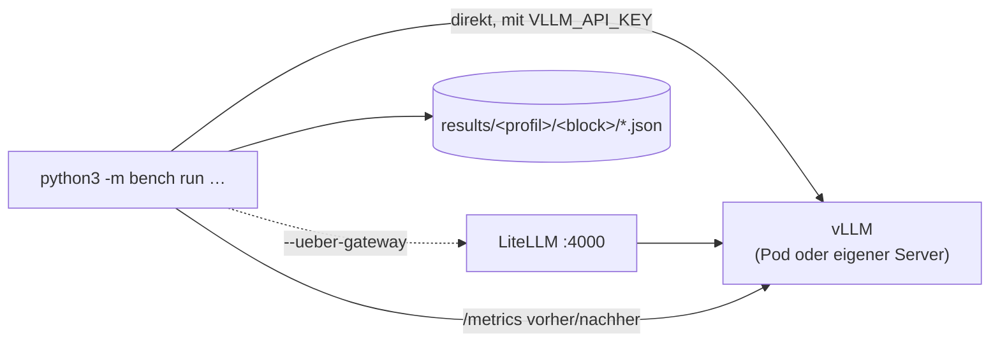

# Phase 2: Testsuite

Misst ein Modell hinter einer OpenAI-kompatiblen API – vLLM direkt, über LiteLLM oder den Mock-Server. Nur Python-Standardbibliothek (ab Python 3.11), keine Installation nötig.



## Bedienung

```bash
python3 -m bench liste                                   # alle Blöcke
python3 -m bench run alle --profil qwen38-27b            # Stufe schnell
python3 -m bench run prefill nadel --profil glm53-flash-fp4 --stufe voll
python3 -m bench run integration --profil mock --ziel http://127.0.0.1:8000/v1
python3 -m bench auswertung --speichern                  # Vergleichstabelle
```

**Woher Ziel und Key kommen:** `--ziel` → Umgebung `BENCH_ZIEL_URL` → `runpod/.aktueller-pod.json` (vom Pod-Skript geschrieben) → `BENCH_ZIEL_URL` in `.env` → `http://127.0.0.1:8000/v1`. Der Key kommt aus der Pod-Datei oder `VLLM_API_KEY` in `.env`. Ohne Key verweigert die Suite den Start (Regel 8), außer beim Mock-Profil.

**Geldschonend:** Bei `alle` laufen zuerst `integration` und `waechter`. Schlägt einer davon fehl, bricht der Lauf ab, bevor teure Blöcke GPU-Zeit kosten (`--weiter` erzwingt den Rest). Jeder Block speichert Dauer und Kosten (`kosten_usd`, aus dem Stundenpreis des Pods).

## Blöcke

| Block | Ebene | Was | Bestanden, wenn |
|---|---|---|---|
| `integration` | Integration | Modellname, Key-Schutz, Chat, Streaming, Token-Zahlen, Tool-Call, Kontext ≥ 64k | alle Prüfungen ok |
| `waechter` | System | 5 Fragen mit bekannter Antwort, einzeln und gebündelt; Schleifen- und Wiederholungserkennung | alles richtig, nichts kaputt |
| `prefill` | System | Zeit bis zum ersten Token, kalt (neuer Text) und warm (Prefix-Cache) | 500k läuft, alle Längen ok |
| `decode` | System | Ausgabetempo pro Nutzer und gesamt bei 1–64 gleichzeitigen Anfragen, natürliche Texte | reine Messung |
| `nadel` | System | Code im langen Text finden | alle gefunden, 500k Pflicht |
| `agent` | Abnahme | Agentenschleife mit Tools (`datei_lesen`, `rechnen`) und langer Doku im Kontext | alle Aufgaben gelöst |
| `bilder` | Abnahme | farbige Quadrate zählen; Zeit bis zum ersten Token mit 0/1/4 Bildern | ≥ 80 % richtig |
| `lastmix` | System | 4 Coding-Agenten + Chat-Nutzer bis 30 gesamt, gegen Zielwerte | Zielwerte bei 30 Nutzern eingehalten |
| `rechnen` | Abnahme | 3 Aufgaben mit bekannter Lösung je Denkstufe, Denk-Tokens | eine Denkstufe löst alles |
| `abap` | Abnahme | 7 Aufgaben (ALV, SQL, CDS, RAP, Fehlersuche, Modernisierung, AMDP), Kriterien + abaplint | reine Messung |

**Stufen:** `schnell` misst die wichtigsten Punkte (8k/128k/500k, 1–16 parallel, Lastmix 12 und 30 Nutzer à 150 s), `voll` alle (bis 1M, bis 64 parallel, Lastmix 8/12/20/30 Nutzer à 480 s, großer Prompt als Störer). Grobe Laufzeit für `alle`: schnell ca. 45–60 Min., voll ca. 2–3 Std. – je nach Modell.

**Zielwerte im Lastmix** (überschreibbar im Profil): `SLO_TTFT_P90_S=3` (Chat, erstes Token), `SLO_MIN_TOK_S=15` (Chat, langsamste 10 %), `SLO_AGENT_TTFT_P90_S=20`.

## Was jedes Ergebnis enthält (Regel 6)

`meta`: Zeitpunkt, Repo-Stand, Profil, Modell und Revision, Image, Startparameter, Hardware und Pod, Stundenpreis, Kalibrierung. Dazu `dauer_s`, `kosten_usd` und `vllm_zaehler` – die Differenz der vLLM-Zähler vor und nach dem Block, mit abgeleiteter Prefix-Cache-Trefferquote und Akzeptanzrate beim spekulativen Decoding. Jede einzelne Anfrage liegt unter `results/raw/` (nicht im Repo).

## Profilwerte, die die Testsuite liest

| Wert | Bedeutung |
|---|---|
| `SERVED_NAME` | Modellname am Server |
| `MAX_MODEL_LEN` | Kontext; längere Messpunkte werden übersprungen |
| `VISION` | `1` = Block `bilder` läuft |
| `DENKSTUFEN` | z. B. `'aus={"chat_template_kwargs":{"enable_thinking":false}};an={}'`; „aus“ wird für Tempo-Messungen genutzt |
| `SLO_*` | Zielwerte für den Lastmix |
| `LASTMIX_DAUER_S` | nur für Selbsttests (Mock) |
| `KEY_PFLICHT` | `0` nur beim Mock |

## Selbsttest ohne GPU

```bash
python3 -m unittest discover -s bench/tests -t . -v                  # wie in der CI
python3 local/mock/mock_openai.py --host 127.0.0.1 --port 8000 &
python3 -m bench run alle --profil mock --weiter
```

Gegen den Mock fallen `waechter`, `nadel`, `agent`, `rechnen` durch – der Mock rechnet nicht. Geprüft wird dabei, dass jeder Block läuft und ein gültiges Ergebnis schreibt.

ABAP-Syntaxprüfung braucht `npx` (Node.js); ohne wird nur nach Kriterien bewertet.
