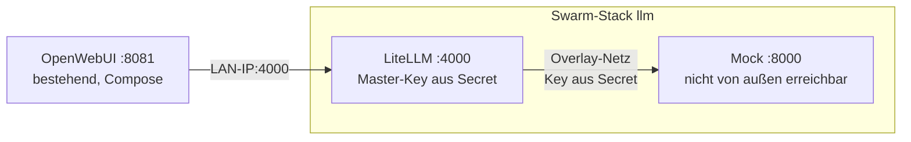

# Phase 1: LiteLLM und Mock-Server im Swarm

Läuft auf dem **Mediaserver** neben der bestehenden OpenWebUI (Port 8081). Noch keine GPU: LiteLLM leitet an einen Mock-Server weiter, der die OpenAI-API von vLLM nachahmt.



## Dateien

| Datei | Zweck |
|---|---|
| `stack.yml` | Swarm-Stack: LiteLLM und Mock, Overlay-Netz `llm`, Secrets, Healthchecks |
| `images.env` | gepinnte Image-Referenz (Regel 4); wird mit `pin-images.sh` gefüllt |
| `litellm/config.yaml` | Modelle und Einstellungen für LiteLLM; Keys nur als `os.environ/…` |
| `litellm/start.sh` | lädt die Docker Secrets als Umgebungsvariablen und startet LiteLLM; bricht ohne Master-Key ab |
| `mock/mock_openai.py` | Mock der OpenAI-API (nur Python-Standardbibliothek): Key-Schutz, Streaming, Tool-Calls, Denk-Text |
| `pin-images.sh` | lädt das Image und trägt den Digest in `images.env` ein |
| `deploy.sh` | prüft Swarm, Pins und Secrets, deployt und wartet, bis alles gesund ist |
| `smoke-test.sh` | Integrationstest: Key-Schutz, Modellliste, Chat, Streaming, Tool-Call |

LiteLLM und Mock nutzen dasselbe Image, weil es Python mitbringt. So muss nur ein Image gepinnt werden.

## Einrichtung (einmalig, auf dem Mediaserver)

**1. Repo holen**

```bash
git clone git@github.com:Kalavera1/SwarmLLM_Benchmark.git ~/projekte/SwarmLLM_Benchmark
cd ~/projekte/SwarmLLM_Benchmark
```

**2. Zugangsdaten anlegen**

```bash
cp .env.example .env
chmod 600 .env
echo "LITELLM_MASTER_KEY=sk-$(openssl rand -hex 24)"   # Ausgabe in .env eintragen
```

Den Master-Key brauchst du gleich noch einmal für OpenWebUI.

**3. Swarm einschalten**

```bash
docker swarm init --advertise-addr <LAN-IP des Mediaservers>
```

Die laufenden Compose-Container, auch die OpenWebUI, merken davon nichts.

**4. Image pinnen**

```bash
cd local
./pin-images.sh
```

Schreibt den Digest in `images.env`. Bitte die Zeile `LITELLM_IMAGE=…` an Claude schicken oder per Pull Request ins Repo übernehmen, damit der Pin versioniert ist.

**5. Deployen**

```bash
./deploy.sh
```

Beim ersten Mal legt das Skript die Secrets an: `litellm_master_key` aus der `.env`, `mock_api_key` zufällig. Dann wartet es, bis beide Services gesund sind.

**6. Testen**

```bash
./smoke-test.sh
```

Erwartet: `Alle Prüfungen bestanden.`

## OpenWebUI anbinden

In der OpenWebUI auf Port 8081:

1. **Admin-Einstellungen → Verbindungen → OpenAI API** → Verbindung hinzufügen
2. **URL:** `http://<LAN-IP des Mediaservers>:4000/v1`
   - nicht `localhost`, denn aus dem OpenWebUI-Container wäre das der Container selbst
3. **Key:** der `LITELLM_MASTER_KEY` aus der `.env`
4. Speichern. In der Modellauswahl erscheint `mock`.

Ein Chat mit `mock` liefert eine feste Antwort („Das ist eine Antwort des Mock-Servers …“). Damit ist die Kette OpenWebUI → LiteLLM → Ziel bewiesen. Ab Phase 4 kommt in der `config.yaml` nur ein weiteres Ziel dazu, an OpenWebUI ändert sich nichts.

**Kommt keine Verbindung zustande?** Dann blockiert vermutlich die Firewall des Mediaservers Port 4000 aus dem Docker-Netz. Prüfen mit `curl http://<LAN-IP>:4000/health/liveliness` vom Host und aus dem Container (`docker exec openwebui curl …`).

## Betrieb

```bash
docker service ls                          # Status
docker service logs -f llm_litellm         # Logs LiteLLM
./deploy.sh                                # nach Änderungen an config.yaml, start.sh oder Mock
docker stack rm llm                        # Stack entfernen (Secrets bleiben)
```

Änderungen an `config.yaml`, `start.sh` oder `mock_openai.py` kommen über `./deploy.sh` an. Das Skript gibt den Swarm-Configs einen neuen Namen mit Inhalts-Hash, weil Swarm-Configs unveränderlich sind.

## Bekannte Grenzen

- **Ohne Datenbank kennt LiteLLM nur den Master-Key.** Eigene Keys pro Nutzer oder Anwendung brauchen eine Postgres-Datenbank. Für die Tests reicht der Master-Key, auch in OpenWebUI.
- **Abweisungen kommen nicht immer als 401.** Ohne Key antwortet LiteLLM (v1.106.6, ohne Datenbank) mit 500, mit falschem Key mit 400 („No connected db“). Abgewiesen wird in beiden Fällen, der Smoke-Test prüft genau das.
